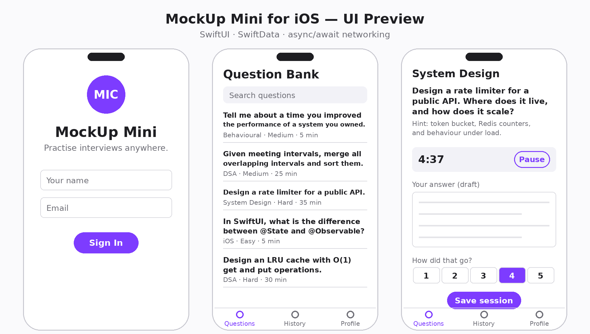

# MockUp Mini for iOS

A SwiftUI companion app for MockUp, an AI mock interview platform, built by Tejal Patel to practise interview questions with timed sessions on iPhone and iPad.

*A rendering of the app screens: sign in, question bank, timed practice, history, and profile.*

## Features

- Sign in with name and email, persisted with @AppStorage
- Question bank with search and category filter
- Timed practice sessions with a start/pause timer
- Session history stored with SwiftData
- Profile screen with session count and average rating
- Offline-first: the app falls back to the bundled question bank when the API is unreachable

## Requirements

- Mac with Xcode 15 or later
- iOS 17 SDK
- No third-party dependencies

## How to run

1. Clone the repository: https://github.com/Tejalpatel2099/mock-mini-ios.git
2. Open MockUpMini.swiftpm in Xcode.
3. Choose an iPhone simulator as the run destination.
4. Press Run (Cmd+R).
5. Sign in with any name and email, then open a question and try a timed practice session.

To point the app at a live API, change the endpoint URL in MockUpMini.swiftpm/QuestionService.swift. If the request fails, the app automatically loads questions.json from the bundle instead.

## Project structure

| File | Description |
| --- | --- |
| MockUpMini.swiftpm/Package.swift | Swift Playground manifest: bundle ID, iOS 17 target, resources |
| MockUpMini.swiftpm/Models.swift | InterviewQuestion struct and the SwiftData SessionRecord model |
| MockUpMini.swiftpm/QuestionService.swift | Actor that fetches questions from the API with a bundled offline fallback |
| MockUpMini.swiftpm/ViewModels.swift | @Observable view models and the practice session timer |
| MockUpMini.swiftpm/MockUpMiniApp.swift | App entry point, SwiftData container, and tab navigation |
| MockUpMini.swiftpm/Views.swift | The five screens: sign in, question bank, practice, history, profile |
| MockUpMini.swiftpm/Resources/questions.json | Bundled offline question bank (10 questions) |
| screenshots/preview.png | UI preview image shown above |
| .gitignore | Ignores the exported zip and macOS metadata |

## Architecture notes

- Light MVVM: views render state owned by small @Observable view models.
- Networking is isolated in the QuestionService actor, so concurrent callers cannot corrupt shared state.
- @AppStorage holds tiny UI state (sign-in flag, user name); SwiftData persists the session history that must survive restarts.
- InterviewQuestion is a struct (value semantics, safe to pass across views); SessionRecord is an @Model class (identity and persistence managed by SwiftData).

## Roadmap

- Voice answers with speech-to-text
- AI feedback on practice answers
- Live API backend
- Unit and UI tests

## About

Built by Tejal Patel.

- LinkedIn: https://www.linkedin.com/in/tejalppatel/
- GitHub: https://github.com/Tejalpatel2099
- Portfolio: https://portfolio-self-xi-37.vercel.app/
